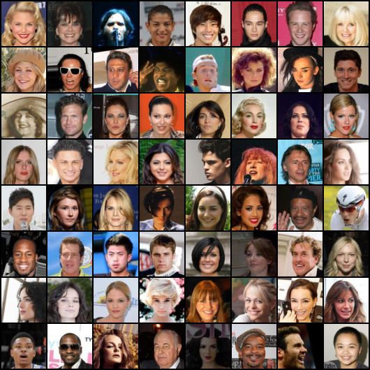
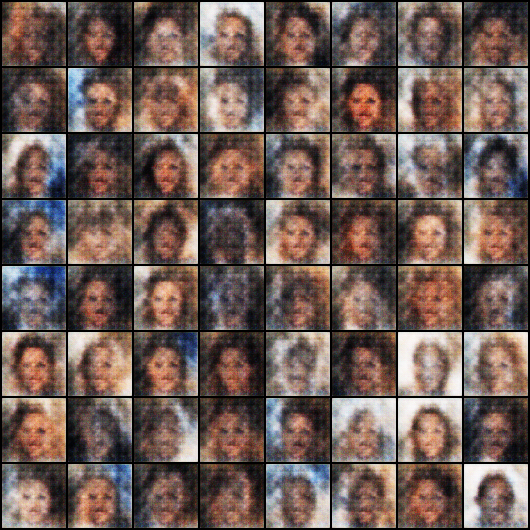
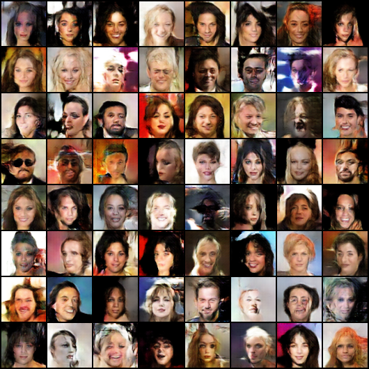
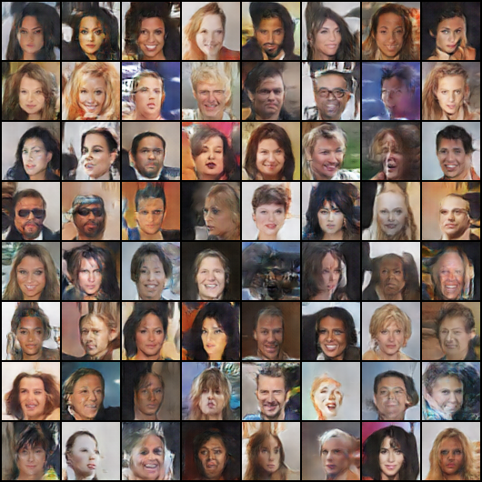
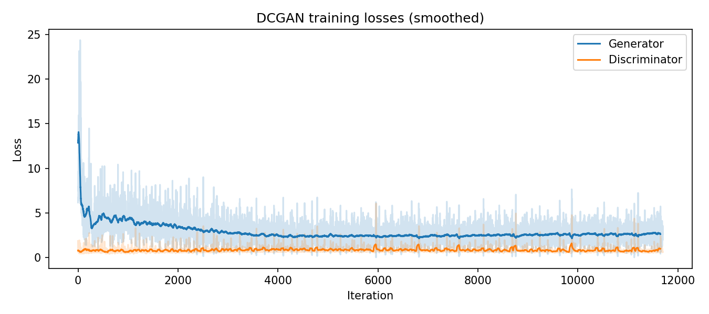

# 🧑 FaceGAN: DCGAN Face Image Generator

A Deep Convolutional GAN (DCGAN) built from scratch in PyTorch that generates 64×64 synthetic face images, trained on the CelebA dataset. Includes a Streamlit demo for generating new faces and blending between two faces.


*64 faces generated by the trained model from random noise. None of these people exist.*

## Results

| Real CelebA images | Generated, epoch 1 | Generated, epoch 15 | Generated, epoch 30 |
|---|---|---|---|
|  |  |  |  |

**Training details:**
- Dataset: CelebA, 50,000 images (random subset of ~202k), resized to 64×64, normalized to [-1, 1]
- Epochs: 30 · Batch size: 128 · Optimizer: Adam (lr 2e-4, β1 0.5) · 390 iterations per epoch
- Hardware: Kaggle free GPU (Tesla T4), about 50 minutes of training
- Evaluation: visual inspection of fixed-noise sample grids saved every epoch, plus loss curves



**Observations:**
- Generator loss fell from about 6.0 (epoch 1) to about 2.6 and then flattened. Discriminator loss stayed near 0.8-0.9, and D(x) ≈ 0.7 and D(G(z)) ≈ 0.2 held steady, so neither network overpowered the other.
- Final samples are recognizable faces with good variety in skin tone, hair, expression, background, and accessories such as glasses, so there is no obvious mode collapse.
- Remaining flaws: some faces are warped or smudged, images are slightly soft, and a few have uneven skin or background artifacts. This is typical of a 64×64 DCGAN trained for a short time.
- The loss curves show two brief spikes that recovered immediately.
- No numeric metric (e.g. FID) was computed. Quality was judged visually.

## Architecture

- **Generator:** latent vector (100) → 4 transposed convolutions (stride 2) with BatchNorm + ReLU → Tanh output, 64×64×3
- **Discriminator:** 4 strided convolutions with BatchNorm + LeakyReLU(0.2) → single real/fake logit
- No pooling or fully connected hidden layers; weights initialized from N(0, 0.02), as in the DCGAN paper
- Loss: BCE with logits; generator trained with the non-saturating objective

**Stabilization choices:** one-sided label smoothing (real label 0.9), Adam β1 = 0.5, fixed noise vector for comparing samples across epochs.

## Project structure

```
models.py    Generator and Discriminator
train.py     Training loop, sample grids, loss plots, checkpoints
generate.py  Generate faces / interpolations from a trained model
utils.py     Loading, seeding, interpolation, image-grid helpers
app.py       Streamlit demo
train_on_kaggle.ipynb   Notebook to train on a free Kaggle GPU
checkpoints/generator.pth   Trained weights (after training)
```

## Train

Free GPU route (recommended): follow the steps in `train_on_kaggle.ipynb`.

Or locally (a GPU is strongly recommended):

```bash
pip install -r requirements.txt
python train.py --data_dir path/to/celeba/images --epochs 30 --max_images 50000
```

Quick smoke test: `python train.py --data_dir path/to/images --epochs 1 --max_images 2000`

Outputs go to `out/`: `generator.pth`, `samples/epoch_XXX.png`, `loss_curves.png`, `losses.csv`.

## Run the demo

The trained weights are already included in `checkpoints/generator.pth`:

```bash
python -m streamlit run app.py
python generate.py --weights checkpoints/generator.pth --n 64 --seed 7
```

## What I learned / challenges

_Write 3-4 honest points, e.g. why discriminator and generator losses oscillate rather than converge, what label smoothing changed, how sample quality changed over epochs, limits of 64×64 DCGAN versus modern models._

## Possible extensions

- Compute FID against real images for a numeric quality score
- Train on the full dataset for more epochs
- Add a conditional version (e.g. generate faces with chosen attributes)
